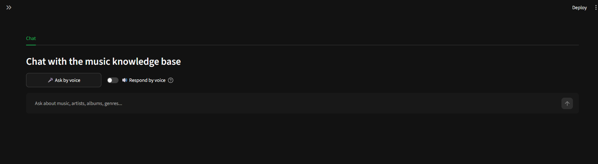

# MusicRAG

A **100% local** music RAG (Retrieval-Augmented Generation) assistant written in Python,
using **SQLite** as the store (chunks + embeddings + FTS5 index) and **Ollama** for
embeddings and the chat model. It builds its own knowledge base **from scratch** from the
documents in `knowledge/`, plus voice-controlled playback of your local audio library
(AIMP) and answers read aloud via speech synthesis.

## Features

- **Semantic** search (cosine similarity over Ollama embeddings, `nomic-embed-text`),
  **lexical** (FTS5/BM25 inside SQLite, no external dependencies) and **hybrid**
  (reciprocal rank fusion).
- RAG with citations: the answer is generated only from retrieved context and lists sources.
- Ingest discography catalogs as `artist`/`album` documents via CLI: `sqlite/music.db`
  (`ingest-musicdb`) and text files under `new_sqlite/` (`ingest-new`).
- **Voice**: ask with your microphone (faster-whisper, with Vosk as a fallback) and have
  answers **read aloud** (Windows TTS, via the UI toggle or `speak`).
- **Play in AIMP**: `musicrag play "play The Trooper by Iron Maiden"` from the indexed
  local library; matching tolerates ASR mistakes (accents, misheard "by/of", artist-only
  requests → first track).
- **Streamlit** UI: single **Chat** tab with the **🎤 Ask by voice** button and the
  **🔊 Respond by voice** toggle.
- Local data and models: nothing leaves your machine.
- Per-document metadata (simple YAML frontmatter): title, type, genre, year...

## Architecture

```
knowledge/ (.md/.txt)          The SOURCE documents (add your own)
     │
     ▼  ── ingest ──────────────────────────────
     │  chunking + embeddings (Ollama nomic-embed-text / local TF-IDF)
     ▼
  SQLite  data/musicrag.db                            CLI  (python -m musicrag)
  ├── documents   metadata                          Streamlit (app.py)
  ├── chunks      content + embedding (BLOB)             │
  ├── chunks_fts  FTS5 index (synced by triggers)        ▼
  └── music_files indexed audio library       ┌──────────────┐
     │                                        │  RAG         │
     │  ask / explore                         │  retrieve →  │
     └─────────► search (semantic/            │  context →   │
                 lexical/hybrid)              │  Ollama chat │
                                              └──────────────┘
                                               ▲          ▲
  sqlite/music.db + new_sqlite/ (artists,      │          │
  albums, songs) ──┬─ ingest-musicdb   ────────┘          │
  G:\[AUDIO] ──┬─ index-audio ────► ──► play/voice   ─►  AIMP
```

## Requirements

- Python 3.11+ (tested on **CPython 3.14** on Windows 11).
- [Ollama](https://ollama.com) running at `http://localhost:11434`.
- Windows (for voice/ASR via sounddevice and spoken answers via SAPI).
- AIMP installed (optional, to play songs).
- Microphone (optional, to ask by voice).

## Installation

```bash
cd MusicRAG
python -m venv .venv
.venv\Scripts\activate          # Windows
pip install -r requirements.txt
```

Ollama models:

```bash
ollama pull nomic-embed-text    # embeddings (semantic search)
ollama list                     # see installed models
```

The chat uses the LLM configured in `musicrag/config.py` by default (`LLM_MODEL`, default
`qwen2.5-coder:1.5b`). Set `MUSICRAG_LLM_MODEL` for another model (e.g. `llama3.2`, `qwen2.5`).

**Note about embeddings:** if the Ollama model is not downloaded, MusicRAG automatically
falls back to a _local backend_ (n-grams with TF-IDF weights computed over the ingested
corpus, also 100% local) and warns about it once. Improve quality with the real model:
`ollama pull nomic-embed-text`. Control: `MUSICRAG_EMBED_BACKEND=auto|ollama|local`.

### Voice (ASR and TTS)

The speech model (`faster-whisper`, ~460 MB) downloads automatically the first time and is
stored in the local Hugging Face cache:

```bash
python -m musicrag voice-setup        # download/verify the model
python -m musicrag mic-test           # microphone diagnostics (level, VAD, raw)
python -m musicrag speak "Hello"      # read text aloud (Windows TTS)
```

If the network blocks the Whisper download, Vosk is used as a fallback engine.

## Quick start (Web UI)

One-click (starts classic Ollama + Streamlit and opens the browser):

```bash
./start.sh                 # http://localhost:8501/
MUSICRAG_PORT=8502 ./start.sh
MUSICRAG_URL=http://localhost:8501 ./start.sh
```

or manually:

```bash
streamlit run app.py
```

1. Optional: `python -m musicrag sample` then `python -m musicrag ingest` to load
   `knowledge/`; `ingest-musicdb` / `ingest-new` for the catalogs.
2. If you have a library at `G:\[AUDIO]`: `python -m musicrag index-audio`.
3. In **Chat**: ask a question (e.g. *"which album mixes rock and opera?"*), click
   **🎤 Ask by voice** to ask with your microphone, or type
   *"play The Trooper by Iron Maiden"* to play it in AIMP.
4. Enable **🔊 Respond by voice** so answers are read aloud.

Re-ingesting replaces the content of the changed document, and you should run `index-audio`
again after adding files to your library.

### Side note: the web app shuts itself down

When the last tab/window of `http://localhost:8501/` is closed, the app waits
`MUSICRAG_EXIT_GRACE` seconds (30 by default) and exits; `start.sh` then cleans up and
also stops the Ollama instance it launched.

## Voice and playback (how it works)

- **Recognition**: records 16 kHz mono until 1.5 s of trailing silence (max 10 s) and
  transcribes with faster-whisper (VAD on). A signal floor (`_MIN_RMS`) prevents Whisper
  from hallucinating "subscribe!" on background noise.
- **Track matching**: `find_audio` scores fuzzy matches of the full title + tokens,
  normalizes articles ("the", "of"...), fuzzy-fixes artists ("metalica" → METALLICA) and,
  when only an artist is requested, plays that artist's first track.
- **AIMP**: the exact file path is opened. If no file exists, it replies "Can't find..."
  and suggests `musicrag index-audio`.

## CLI

```bash
python -m musicrag sample                 # create sample documents
python -m musicrag ingest                 # ingest all of knowledge/
python -m musicrag ingest file.md         # ingest one file
python -m musicrag ingest-musicdb         # ingest sqlite/music.db (SQLite catalog)
python -m musicrag ingest-new             # ingest the text catalog in new_sqlite/
python -m musicrag purge-new              # remove new_sqlite docs from musicrag.db
python -m musicrag sync                   # remove orphan docs of sqlite/music.db
python -m musicrag index-audio            # index the G:/[AUDIO] library into music_files
python -m musicrag play "play One by Metallica"           # play in AIMP
python -m musicrag voice                  # transcribe a question from the microphone
python -m musicrag mic-test               # microphone diagnostics
python -m musicrag voice-setup            # download/verify the voice model
python -m musicrag speak "hello"          # read text aloud (Windows TTS)
python -m musicrag search "opera album" --mode hybrid
python -m musicrag ask "what defines Billie Eilish?" --top-k 5
python -m musicrag docs                   # ingested documents
python -m musicrag stats                  # knowledge base stats
python -m musicrag models                 # Ollama models
python -m musicrag reset                  # wipe the knowledge base
python -m musicrag purge-knowledge        # remove and delete the content of knowledge/
```

## Document format

```markdown
---
title: Example artist
type: artist      # artist | album | song | genre | general
genre: rock
active_years: 1990-2010
---
Document text in markdown or plain text. It is split into chunks around sentences,
embedded, and stored in SQLite along with the embedding.
```

Without frontmatter: the title is the file name and the type is `general`.

## Configuration (environment variables)

| Variable | Default | Description |
| --- | --- | --- |
| `OLLAMA_HOST` | `http://localhost:11434` | Ollama server host |
| `MUSICRAG_EMBED_MODEL` | `nomic-embed-text` | Embeddings model |
| `MUSICRAG_LLM_MODEL` | `qwen2.5-coder:1.5b` | Chat model |
| `MUSICRAG_EMBED_BACKEND` | `auto` | `auto`, `ollama` or `local` |
| `MUSICRAG_TOP_K` | `5` | Chunks retrieved per query |
| `MUSICRAG_CHUNK_TOKENS` | `300` | Chunk size |
| `MUSICRAG_CHUNK_OVERLAP` | `40` | Chunk overlap |
| `MUSICRAG_DB` | `data/musicrag.db` | SQLite database path |
| `MUSICRAG_DATA_DIR` | `data/` | Data folder (db, local embeddings) |
| `MUSICRAG_MUSICDB` | `../sqlite/music.db` | External SQLite catalog |
| `MUSICRAG_NEW_SQLITE` | `../new_sqlite` | Text-based catalog |
| `MUSICRAG_KNOWLEDGE_DIR` | `knowledge/` | Documents folder |
| `MUSICRAG_AUDIO_DIR` | `G:/[AUDIO]` | Audio library (for `index-audio`) |
| `MUSICRAG_AIMP` | `C:\Program Files\AIMP\AIMP.exe` | AIMP executable |
| `MUSICRAG_WHISPER_MODEL` | `small` | faster-whisper model size |
| `MUSICRAG_EXIT_GRACE` | `30` | Seconds with no open tab before shutting down |
| `MUSICRAG_URL` / `MUSICRAG_PORT` | `localhost:8501` | URL/port for `start.sh` |

## Troubleshooting

- **Ollama not responding** → check the service is up (`ollama serve`) and `OLLAMA_HOST`.
  The UI warns and uses the local embeddings backend.
- **Embeddings model missing** → `ollama pull nomic-embed-text`. Until then the local
  backend is used (lower semantic quality).
- **LLM missing from the selector** → `ollama list`; if there are no chat models,
  `ollama pull llama3.2` (or whichever you prefer) and restart the app.
- **Speech isn't heard / "Didn't catch that"** → run `python -m musicrag mic-test`: if the
  signal level is too low (RMS < `_MIN_RMS`) nothing is transcribed to avoid Whisper
  hallucinating; get closer to the mic or raise the device volume.
- **"Can't find X" when asking for a song** → the song/artist is not in the indexed audio
  library (remember `musicrag index-audio` after adding files).
- **Closing the tab doesn't shut anything down** → check `MUSICRAG_EXIT_GRACE` (30 s by
  default) and that the tab is the last one open.
- **`data/musicrag.db` and `-wal/-shm` files** → normal: SQLite in WAL mode.

## Screenshot



[DeepWiki Project Page](https://deepwiki.com/moraisLuismNet/MusicRAG)
